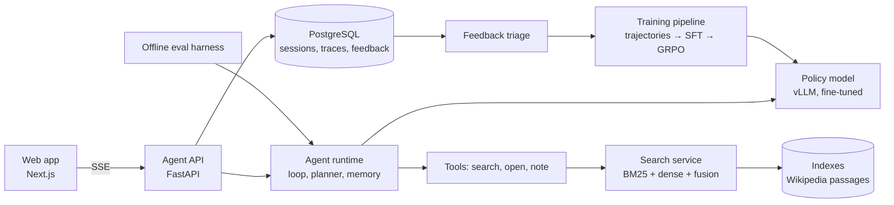

# AI Search Answer Engine — Project Plan

A self-hosted AI search product: a user asks a question, an agent plans, searches Wikipedia, reads, takes notes, and returns a short answer card with numbered citations. The model behind the agent is a small open LLM that this project fine-tunes (SFT) and then trains with reinforcement learning (GRPO) to use its tools well. Usage feeds back into training.

**Target role:** LLM/Multimodal AI Engineer Intern (TikTok Search), 2027 start.

---

## 1. Goals and non-goals

### Goals

1. **A working product end to end:** search service → agent runtime → trained model → model serving → web app → evaluation and feedback loop.
2. **Explicit agent modules, each measured on its own:** planning, working memory, conversation memory, tool use, evaluation.
3. **A model trained here, not just prompted:** show the gain from prompted → SFT → SFT + RL on standard multi-hop QA benchmarks.
4. **Runs without a hosted LLM at serving time.** Hosted models are used only offline: to generate SFT trajectories, as a quality ceiling, and as a calibrated judge.
5. **Same rigor as previous projects:** frozen splits, configurations chosen on validation only, test touched once per final number, bootstrap intervals, ties and losses reported as results.

### Non-goals

- Beating state-of-the-art search agents. The point is a clean, measured system, not a leaderboard entry.
- Live web search. The corpus is a fixed Wikipedia dump so every result is reproducible.
- Long research reports. Answers are short and cited, like a search Q&A card.
- Multimodal and video. Possible later extension, out of scope for v1.

### How the project maps to the posting

| Posting asks for | Where it lives in this project |
|---|---|
| AI Search Agent: planning, memory, tool-use, evaluation modules | `agent/planner`, `agent/memory`, `agent/tools`, `eval/` (Sections 4, 8) |
| LLM-based query understanding, multi-turn conversation | Query rewriting inside the plan; conversation memory for follow-ups (4.4) |
| LLM adaptation: data prep, fine-tuning, RL feedback analysis | Trajectory generation, SFT, GRPO, behavior analysis (Section 5) |
| RAG optimization, answer quality evaluation, structured results | Search service, LLM judge, answer card with citations (Sections 3, 7, 8) |

---

## 2. System overview



Every request produces a **trace**: the plan, each tool call and result, notes, the final answer, timings and token counts. Traces are the unit for debugging, evaluation, the UI's step display, and the feedback loop.

---

## 3. Component 1 — Corpus and search service

### Corpus

| Stage | Corpus | Size | Why |
|---|---|---|---|
| Development (M1–M4) | HotpotQA's Wikipedia abstracts dump | ~5M paragraphs | Cheap to index; enough to get the full loop working |
| Final (M5 onward) | Wikipedia 2018 passages (DPR split, 100-word passages) | ~21M passages | Used by most search-agent papers, so numbers are comparable |

Check FlashRAG's preprocessed corpora and datasets before writing any preprocessing; it may save a week.

**Index size check for the final corpus:** 21M × 768-dim vectors is ~64 GB in fp32 and ~32 GB in fp16. Plan for FAISS IVF-PQ or HNSW with product quantization, or a smaller embedding dimension. Decide in M1 after measuring recall loss from quantization on a sample.

### Retrieval

- **BM25:** `bm25s` or Pyserini.
- **Dense:** an off-the-shelf retriever (e5-base-v2 is what Search-R1 used; bge-base is an alternative). No retriever fine-tuning in v1; retrieval is not the focus.
- **Fusion:** reciprocal rank fusion, weights chosen on a validation fold.
- **Optional reranker:** a small cross-encoder over the top 20, kept only if it pays for its latency on validation.

### Service

- FastAPI endpoint: `POST /search {query, k}` → passages with `doc_id`, `title`, `text`, `score`.
- `GET /doc/{doc_id}` → full article (all passages of that title, in order) for the `open` tool.
- **Latency budget:** p95 under 150 ms for `search` on the final corpus. Measured, not assumed.
- Each stage has a deadline; on timeout return partial results marked `degraded` rather than failing.

### Measured here

Recall@k of gold supporting passages (HotpotQA provides supporting facts) for BM25, dense and fused, on a validation sample. This sets an upper bound on what the agent can find.

---

## 4. Component 2 — Agent runtime

Written from scratch. No LangChain or LangGraph, because the posting values building the runtime itself.

### 4.1 The loop

```
state = {question, conversation_memory, plan, notes, context, step=0}
while step < MAX_STEPS:
    action = policy(state)            # model emits exactly one action
    if action is ANSWER: return answer, citations, trace
    result = run_tool(action)         # search | open | note | plan
    state = update(state, action, result)
    state = trim_context_if_needed(state)   # keeps plan + notes, drops old results
    step += 1
return forced_answer(state)           # answer from notes when budget runs out
```

- **Action format:** tagged text the model can learn easily, e.g. `<plan>…</plan>`, `<search>…</search>`, `<open>doc_id</open>`, `<note>…</note>`, `<answer>…</answer>`. Tool results come back inside `<result>…</result>`.
- **Parsing and guardrails:** malformed action → one retry with an error message, then forced answer. Duplicate searches are detected and returned with a warning instead of re-running.
- **Budgets:** `MAX_STEPS` (default 8), max tokens per tool result, total context limit.

### 4.2 Tools

| Tool | Input | Output | Purpose |
|---|---|---|---|
| `search` | query string | top-k snippets with `doc_id` and title | Find candidate evidence |
| `open` | `doc_id` | full article text, truncated to a budget | Read when a snippet isn't enough |
| `note` | free text, with source `doc_id` | confirmation | Save a fact to working memory |
| `plan` | list of sub-questions | confirmation | Write or revise the plan |

Every tool call, input, output size and latency is recorded in the trace.

### 4.3 Planning module

- Before the first search, the model writes a plan: the question broken into ordered sub-questions, e.g. *1. Who directed X? 2. Where was that person born?*
- After each result, the model may mark a sub-question resolved or revise the plan.
- The current plan is always kept in context, never trimmed.
- **Ablation:** planning on vs off, reported overall and by hop count (MuSiQue 2-, 3- and 4-hop).

### 4.4 Memory module

**Working memory (within one question)**

- The `note` scratchpad: short facts with their source `doc_id`.
- When context exceeds the limit, old tool results are dropped first; plan and notes are kept. Citations in the final answer must point to a noted or still-present source.
- **Ablation:** with vs without `note`, and with a tight vs loose context budget, on long (3–4 hop) questions.

**Conversation memory (across turns)**

- After each answered turn, store: the question, the answer, resolved entities (e.g. "she" → the person found), and the notes that supported the answer.
- On a follow-up, the model first rewrites it into a standalone question using that memory, then decides whether earlier notes already answer it or a new search is needed.
- **Evaluation data:** QReCC (conversational QA with question rewrites) plus a small set of follow-up chains built from HotpotQA, spot-checked by hand.
- **Ablation:** follow-up accuracy with full conversation memory vs rewrite only vs no memory, plus searches saved when earlier notes suffice.

### 4.5 Citations

- Answer format: short answer, then 1–3 sentences of support, each sentence ending with `[n]` references to `doc_id`s.
- Validation before returning: every `[n]` must refer to a passage actually retrieved in this trace. Invalid citations are removed and counted as a metric.

---

## 5. Component 3 — Data and training

### 5.1 Datasets

| Dataset | Use | Notes |
|---|---|---|
| HotpotQA (~90k train) | SFT trajectories, RL, eval | 2-hop; distractor setting not used — the agent searches the full corpus |
| 2WikiMultiHopQA (~167k train) | RL question pool | More templated; good volume |
| MuSiQue (~20k train) | RL, hardest eval | 2–4 hops, built to block shortcuts |
| Natural Questions, TriviaQA | Eval only | Single-hop; checks the agent doesn't over-search easy questions |
| QReCC | Conversation memory eval | Multi-turn |

### 5.2 Splits and discipline

- Training uses train splits only.
- Each benchmark's official dev set is the **test set** for this project, touched once per final number, behind a `--final` flag.
- A **validation set** is carved from train by question (and frozen with a checksum) for every choice: prompts, hyperparameters, reward weights, checkpoints.
- Feedback-loop data (Section 8.3) never enters validation or test.
- Check for overlap between train questions used for SFT/RL and test questions (exact and near-duplicate) and report it.

### 5.3 Base model

- A Qwen-family instruct model, 1.5B–4B parameters (use the newest available at M3). Start at the small end; move up only if the small one plateaus.
- LoRA for SFT; LoRA or full fine-tuning for RL depending on memory.

### 5.4 Trajectory generation (SFT data)

1. Run a strong hosted model through the exact same runtime and tool format on ~5–10k training questions.
2. Keep trajectories that end in a correct answer (exact match or F1 above a threshold) and have valid citations.
3. Filter out degenerate ones: more than `MAX_STEPS − 1` steps, repeated identical searches, no plan.
4. Record yield (fraction kept) and the step-count distribution.

### 5.5 SFT

- Train on the filtered trajectories with loss on the model's own tokens only; tool results are masked from the loss.
- Choose epochs and learning rate on validation accuracy, not training loss.

### 5.6 RL (GRPO)

- **Framework:** verl (Search-R1 builds on it) or TRL. Confirm multi-turn tool rollout support before committing at the start of M5.
- **Rollouts:** the policy runs the real runtime against the real search service; retrieved text is masked from the loss.
- **Reward:**
  - `+1` for a correct final answer (exact match, with F1 as a variant)
  - `−λ` per tool call beyond the first, λ small (start at 0.02, tune on validation)
  - `−0.5` for a malformed action or no answer
  - optional: small penalty for invalid citations
- **Watch for:** reward hacking (very short answers, skipping search on hard questions), collapse to one search per question, rising format errors. Track all three during training.
- **Starting point:** initialize RL from the SFT checkpoint. Also run RL from the base model as an ablation if compute allows.

### 5.7 Behavior analysis (as important as the accuracy numbers)

- Tool calls per question, by hop count, before and after RL.
- How often `open` is used, and whether it helps when used.
- Query reformulation after a failed search: frequency and success rate.
- Plan revisions: how often, and whether revised plans end in correct answers more often.
- 50 failures from the final model, categorized by hand (retrieval miss, reasoning error, wrong entity, gave up, etc.).

---

## 6. Component 4 — Model serving

- vLLM with an OpenAI-compatible endpoint; LoRA adapter loaded at serve time or merged weights.
- Prefix caching on, since the system prompt and tool descriptions repeat across requests.
- **Measured:** time to first token, total answer time (p50 and p95), steps per request, tokens per request, all on a fixed set of 200 validation questions on idle hardware.
- Optional: an INT8 or AWQ quantized variant with an accuracy vs latency comparison.
- Fallback: if the model server is down, the API returns a typed, retryable error; it never silently switches to a hosted model.

---

## 7. Component 5 — Web app

- **Frontend:** Next.js (familiar from the RAG bot).
- **Streaming:** Server-Sent Events from the agent API. The page shows each step live: the plan, "Searching: …", "Reading: Article title", notes.
- **Answer card:** short answer, support sentences with numbered citations, a sources list with titles and snippets. Steps collapse once the answer arrives.
- **Follow-ups:** the conversation continues in the same session using conversation memory.
- **Feedback:** thumbs up/down on every answer, optional free-text reason.
- **Trace view (debug mode):** full trace for any answer, including timings. Useful for interviews and demos.

---

## 8. Component 6 — Evaluation and feedback loop

### 8.1 Metrics

| Metric | What it measures |
|---|---|
| Exact match, F1 | Answer correctness against gold |
| LLM-judge accuracy | Correctness when wording differs from gold |
| Citation validity | Share of citations pointing to retrieved passages |
| Citation support | Share of cited passages that actually support the claim (LLM judge) |
| Tool calls per question | Efficiency |
| Latency p50 / p95 | User-facing speed |
| Follow-up accuracy | Conversation memory quality |

**Judge calibration:** label 150–200 answers by hand, measure judge agreement and Cohen's κ, and report them. Do not use the judge for any number until agreement is measured.

**Statistics:** 95% bootstrap intervals over questions for every reported number; McNemar's test for paired accuracy comparisons between systems.

### 8.2 Systems compared

| # | System | Role |
|---|---|---|
| B0 | Small model, no retrieval | Floor |
| B1 | Small model, single search then answer (fixed RAG) | Standard baseline |
| B2 | Small model, prompted agent with all tools | Effect of the runtime alone |
| B3 | Strong hosted model, same agent and tools | Ceiling |
| S1 | Small model after SFT | Effect of SFT |
| S2 | Small model after SFT + GRPO | Effect of RL — the headline |

### 8.3 Ablations (all on S2 unless stated)

| Ablation | Question it answers |
|---|---|
| Planning off | Does explicit planning help, and on which hop counts? |
| `note` off | Does working memory help on long questions? |
| `open` off | Is full-article reading worth its tokens? |
| Conversation memory: full / rewrite only / none | What does memory buy on follow-ups? |
| Tool-call penalty λ: 0 / chosen / 2× | Accuracy vs efficiency trade-off |
| RL from base vs from SFT | Is the SFT warm start necessary? |
| Dev corpus vs final corpus | How much does corpus size change accuracy and latency? |

### 8.4 Feedback loop

1. Every live request is stored with its trace.
2. Thumbs-down answers enter a triage queue.
3. Triage: an LLM judge proposes a label and failure category; you confirm or correct it by hand.
4. Confirmed failures with a known correct answer become new training questions; the trajectory generator runs on them.
5. A retraining round (SFT top-up, then a short RL run) produces a new checkpoint.
6. The new checkpoint is promoted only if it beats the current one on the frozen validation set without regressing on any benchmark.

For the project, run at least **one full round** of this loop using queries from yourself and a few friends, and report what changed.

---

## 9. Milestones

Time estimates assume part-time work alongside classes. Each milestone ends with something committed and measured.

| M | Deliverable | Exit criteria | Est. |
|---|---|---|---|
| **M0** | Repo, environment, frozen splits, eval harness skeleton | `pytest` passes; splits checksummed; EM/F1 scorer matches official scripts on sample outputs | 3–4 days |
| **M1** | Search service on dev corpus | Recall@k reported for BM25 / dense / fused; p95 latency measured | 1 week |
| **M2** | Agent runtime with all tools, planner, working memory; hosted model as policy | B3 ceiling measured on validation; traces stored | 1–1.5 weeks |
| **M3** | Web app with streaming steps and answer card; conversation memory | Working demo end to end with hosted model; follow-up eval running | 1 week |
| **M4** | Trajectory generation + SFT; small model served with vLLM | B0, B1, B2, S1 measured; app switched to own model | 1.5–2 weeks |
| **M5** | Final corpus; GRPO training | S2 measured on validation; training curves and behavior stats logged | 2–3 weeks |
| **M6** | Ablations, judge calibration, test numbers (run once) | Full results table with intervals; failure analysis done | 1 week |
| **M7** | Feedback loop round, write-up, README, demo video | One retraining round reported; RESULTS.md complete | 1 week |

**Total:** roughly 10–12 weeks part-time.

**Minimum shippable version:** M0–M4. It already has a trained model, explicit agent modules, a product and measured baselines. If time runs short, apply with this and keep RL as in-progress work.

---

## 10. Repository layout

```
ai-search-agent/
├── search/            # corpus loading, indexing, search service
├── agent/
│   ├── runtime.py     # the loop, budgets, guardrails
│   ├── actions.py     # action format, parsing
│   ├── planner.py
│   ├── memory.py      # working memory, context trimming, conversation memory
│   ├── tools.py
│   └── citations.py
├── train/
│   ├── trajectories.py
│   ├── sft.py
│   ├── grpo.py
│   └── rewards.py
├── serve/             # vLLM launch config, agent API (FastAPI, SSE)
├── web/               # Next.js app
├── eval/
│   ├── harness.py     # runs any system on any split
│   ├── metrics.py
│   ├── judge.py       # LLM judge + calibration
│   └── ablations.py
├── feedback/          # triage queue, relabeling, retraining round
├── splits/            # frozen validation questions + checksums
├── docs/
│   ├── RESULTS.md
│   ├── results/       # every reported number as committed JSON
│   └── plans/
├── tests/
├── compose.yaml
└── README.md
```

Same rule as the ESCI project: every number in the README and RESULTS.md is read from a committed file in `docs/results/`, and a test fails if one is not.

---

## 11. Tech stack

| Layer | Choice |
|---|---|
| Language | Python 3.12+ (backend, training), TypeScript (web) |
| Retrieval | bm25s or Pyserini; FAISS; e5-base-v2 or bge-base |
| Agent API | FastAPI, SSE |
| Serving | vLLM |
| Training | Hugging Face Transformers, PEFT (LoRA), verl or TRL for GRPO |
| Storage | PostgreSQL (sessions, traces, feedback) |
| Web | Next.js |
| Tracking | Weights & Biases or MLflow for training runs |
| Packaging | uv, Docker Compose |

---

## 12. Compute and cost (rough, to confirm)

| Item | Estimate |
|---|---|
| Dense index of final corpus | One-time embedding job, a few GPU-hours; 30–60 GB storage before quantization |
| Trajectory generation | 5–10k questions × several hosted-model calls; set a hard spend cap |
| SFT (≤4B, LoRA) | A few hours on one 24–48 GB GPU |
| GRPO | The expensive part: plan for one 80 GB GPU for tens of hours; rent by the hour |
| Serving | One consumer GPU (≥16 GB) for a ≤4B model |

Keep a spend ledger like the RAG bot's: every paid call reserves its cost against a daily cap.

---

## 13. Risks and mitigations

| Risk | Mitigation |
|---|---|
| RL unstable or too expensive | M0–M4 is a complete project on its own; start RL with the smallest model and short runs |
| Final corpus too big for local hardware | Stay on the dev corpus and report it clearly; or quantize the index |
| Hosted-model trajectories low yield on hard questions | Mix in easier questions; allow F1-threshold acceptance; report yield |
| Reward hacking | Track answer length, searches per question and format errors during training; inspect samples every checkpoint |
| Judge disagrees with humans | Calibrate first; fall back to EM/F1 for headline numbers |
| Train/test contamination | Overlap check in M0; feedback data kept out of eval |
| Overlap with the RAG bot in interviews | Lead with what's new: a trained policy, explicit agent modules, RL behavior analysis, serving your own model |

---

## 14. Open decisions (settle at the milestone shown)

- Dense retriever: e5-base-v2 vs bge-base (M1, by recall on validation).
- Index type and quantization for the final corpus (M1 → M5).
- Base model and size (M4).
- verl vs TRL for multi-turn GRPO (start of M5).
- Answer correctness for reward: exact match vs F1 vs judge (M5, on validation).
- Whether to include the cross-encoder reranker (M1, only if it pays for its latency).

---

## 15. What you'll have at the end

- A live demo: question in, streamed steps, cited answer card, follow-ups that remember context.
- A results table: prompted → SFT → SFT + RL against fixed RAG and a strong-model ceiling, with intervals.
- One ablation number each for planning, working memory, conversation memory, and tool use.
- A behavior analysis of what RL changed in how the agent searches.
- One completed feedback-loop round.

**Resume line shape:** *Built an AI search answer engine with a self-trained 3B agent (SFT + GRPO) that plans, searches and cites Wikipedia; raised MuSiQue accuracy from X to Y over prompted baseline while cutting tool calls by Z%; served with vLLM at p95 N s, with a feedback loop that turns failed queries into training data.*
