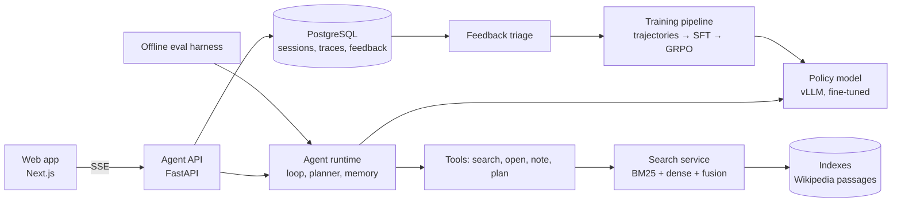

# AI Search Answer Engine — Project Plan

A self-hosted AI search product: a user asks a question, an agent plans, searches Wikipedia, reads, takes notes, and returns a short answer card with numbered citations. The model behind the agent is a small open LLM that this project fine-tunes (SFT) and then trains with reinforcement learning (GRPO) to use its tools well. Usage feeds back into training.

**Target role:** LLM/Multimodal AI Engineer Intern (TikTok Search), 2027 start.

---

## 1. Goals and non-goals

### Goals

1. **A working product end to end:** search service → agent runtime → trained model → model serving → web app → evaluation and feedback loop.
2. **Explicit agent modules, each measured on its own:** planning, working memory, conversation memory, tool use, evaluation.
3. **A model trained here, not just prompted:** show the gain from prompted → SFT → SFT + RL on standard multi-hop QA benchmarks.
4. **Runs without a hosted LLM at serving time.** Hosted models are used only offline: to generate SFT trajectories, as a quality ceiling, and as a secondary judge.
6. **No manual work.** Every label, check and dataset in this project is produced by code or a model. Headline numbers use metrics computed against gold answers, so nothing depends on hand labels.
5. **Same rigor as previous projects:** frozen splits, configurations chosen on validation only, test touched once per final number, bootstrap intervals, ties and losses reported as results.

### Non-goals

- Beating state-of-the-art search agents. The point is a clean, measured system, not a leaderboard entry.
- Live web search. The corpus is a fixed Wikipedia dump so every result is reproducible.
- Long research reports. Answers are short and cited, like a search Q&A card.
- Multimodal and video. Possible later extension, out of scope for v1.

### How the project maps to the posting

| Posting asks for | Where it lives in this project |
|---|---|
| AI Search Agent: planning, memory, tool-use, evaluation modules | `agent/planner`, `agent/memory`, `agent/tools`, `eval/` (Sections 4, 8) |
| LLM-based query understanding, multi-turn conversation | Query rewriting inside the plan; conversation memory for follow-ups (4.4) |
| LLM adaptation: data prep, fine-tuning, RL feedback analysis | Trajectory generation, SFT, GRPO, behavior analysis (Section 5) |
| RAG optimization, answer quality evaluation, structured results | Search service, LLM judge, answer card with citations (Sections 3, 7, 8) |

### How this differs from Search-R1 and similar work

Search-R1, R1-Searcher, ReSearch and ZeroSearch already train small models with RL to call a search tool, and interviewers for search roles will know them. This project does not claim the method is new. It is new in five places, and the write-up should lead with them:

1. **Explicit modules the RL policy is free to drop.** `plan` and `note` are tools, not forced templates. Whether RL keeps, changes or abandons them is a reported finding (5.7).
2. **Efficiency in the reward.** Per-call penalties on retrieval and, more lightly, on `plan`/`note`, swept, give an accuracy vs tool-call trade-off curve rather than one point.
3. **A served product.** The trained model runs behind a streaming app with citations, follow-ups, latency numbers and a feedback loop.
4. **Comparison to published numbers.** S2 is reported next to Search-R1's published results for the same model size and benchmarks, on the same corpus and retriever where possible.
5. **A direct test of whether RL was worth it.** S2 is compared with an SFT-only model given the same compute (5.5b), which answers the first question a sharp reviewer will ask.

---

## 2. System overview



Every request produces a **trace**: the plan, each tool call and result, notes, the final answer, timings and token counts. Traces are the unit for debugging, evaluation, the UI's step display, and the feedback loop.

---

## 3. Component 1 — Corpus and search service

### Corpus

| Stage | Corpus | Size | Why |
|---|---|---|---|
| Development (M1–M4) | HotpotQA's Wikipedia abstracts dump | ~5M paragraphs | Cheap to index; enough to get the full loop working |
| Final (M5 onward) | Wikipedia 2018 passages (DPR split, 100-word passages) | ~21M passages | Used by most search-agent papers, so numbers are comparable |

The dev corpus only holds article intro paragraphs, so it fits HotpotQA but not MuSiQue or TopiOCQA, whose evidence is often deeper in the article. Until M5, run development numbers on HotpotQA only and don't read anything into MuSiQue or TopiOCQA results on the dev corpus.

Check FlashRAG's preprocessed corpora and datasets, and the corpus Search-R1 released, before writing any preprocessing. Using their files can save a week and keeps the numbers comparable. Search-R1's released e5 index is uncompressed (~64 GB), so it doesn't fit this project's hardware; build a compressed one from the same corpus with the same e5 model instead.

**Index size and hardware:** 21M × 768-dim vectors is ~64 GB in fp32 and ~32 GB in fp16, plus ~13 GB of passage text. The laptop has 23 GB of RAM visible to WSL and an RTX 3080 with 16 GB. So the final index is compressed:
- **FAISS IVF-PQ** at 64 bytes per vector: ~1.5–3 GB in RAM.
- **Passage text memory-mapped** from disk and read on demand, not loaded into RAM.
- BM25 index: a few GB.

That puts the whole search service at roughly 5–8 GB of RAM, so the final corpus runs on the laptop. The one-time embedding job takes a few hours on the 3080. In M1, measure the recall lost to PQ on a validation sample against an uncompressed index of a 1M-passage subset, and report it. If the loss is more than a few points, raise the PQ code size (e.g. 96 or 128 bytes) before considering anything else.

### Retrieval

- **BM25:** `bm25s` or Pyserini.
- **Dense:** an off-the-shelf retriever (e5-base-v2 is what Search-R1 used; bge-base is an alternative). No retriever fine-tuning in v1; retrieval is not the focus.
- **Fusion:** reciprocal rank fusion, weights chosen on a validation fold.
- **Optional reranker:** a small cross-encoder over the top 20, kept only if it pays for its latency on validation.

### Service

- FastAPI endpoint: `POST /search {query, k}` → passages with `doc_id`, `title`, `text`, `score`.
- `GET /doc/{doc_id}` → full article (all passages of that title, in order) for the `open` tool.
- **Latency budget:** p95 under 150 ms for `search` on the final corpus. Measured, not assumed.
- Each stage has a deadline; on timeout return partial results marked `degraded` rather than failing.

### Measured here

Recall@k of gold supporting passages (HotpotQA provides supporting facts) for BM25, dense and fused, on a validation sample. This sets an upper bound on what the agent can find.

---

## 4. Component 2 — Agent runtime

Written from scratch. No LangChain or LangGraph, because the posting values building the runtime itself.

### 4.1 The loop

```
state = {question, conversation_memory, plan, notes, context, actions=0, retrievals=0}
while actions < MAX_ACTIONS and retrievals < MAX_RETRIEVALS:
    action = policy(state)            # model emits exactly one action
    if action is ANSWER: return answer, citations, trace
    result = run_tool(action)         # search | open | note | plan
    state = update(state, action, result)
    state = trim_context_if_needed(state)   # keeps plan + notes, drops old results
    actions += 1
    if action in (SEARCH, OPEN): retrievals += 1
return forced_answer(state)           # answer from notes when budget runs out
```

- **Action format:** tagged text the model can learn easily, e.g. `<plan>…</plan>`, `<search>…</search>`, `<open>doc_id</open>`, `<note>…</note>`, `<answer>…</answer>`. Tool results come back inside `<result>…</result>`.
- **Parsing and guardrails:** malformed action → one retry with an error message, then forced answer. Duplicate searches are detected and returned with a warning instead of re-running.
- **Budgets:** `MAX_RETRIEVALS` (default 6) counts only `search` and `open`; `MAX_ACTIONS` (default 16) caps everything. One shared step limit would be too tight: a 4-hop MuSiQue question needs a plan, about 4 searches and several notes, which already goes past 8 steps. Also capped: tokens per tool result and total context.
- **One implementation, used everywhere:** the action parser, tool executor and prompt template live in `agent/` and are imported by the app, the eval harness, trajectory generation and the RL rollout worker. A parity test runs one fixed trajectory through the serving path and the training path and checks that the token sequences are identical. Differences between training and serving formats are the most common silent bug in this kind of project.

### 4.2 Tools

| Tool | Input | Output | Purpose |
|---|---|---|---|
| `search` | query string | top-k snippets with `doc_id` and title | Find candidate evidence |
| `open` | `doc_id` | full article text, truncated to a budget | Read when a snippet isn't enough |
| `note` | free text, with source `doc_id` | confirmation | Save a fact to working memory |
| `plan` | list of sub-questions | confirmation | Write or revise the plan |

Every tool call, input, output size and latency is recorded in the trace.

### 4.3 Planning module

- Before the first search, the model writes a plan: the question broken into ordered sub-questions, e.g. *1. Who directed X? 2. Where was that person born?*
- After each result, the model may mark a sub-question resolved or revise the plan.
- The current plan is always kept in context, never trimmed.
- **Ablation:** planning on vs off, reported overall and by hop count (MuSiQue 2-, 3- and 4-hop).

### 4.4 Memory module

**Working memory (within one question)**

- The `note` scratchpad: short facts with their source `doc_id`.
- When context exceeds the limit, old tool results are dropped first; plan and notes are kept. Citations in the final answer must point to a noted or still-present source.
- **Ablation:** with vs without `note`, and with a tight vs loose context budget, on long (3–4 hop) questions.

**Conversation memory (across turns)**

- After each answered turn, store: the question, the answer, resolved entities (e.g. "she" → the person found), and the notes that supported the answer.
- On a follow-up, the model first rewrites it into a standalone question using that memory, then decides whether earlier notes already answer it or a new search is needed.
- **Training:** the agent itself is trained only on single questions. Follow-ups work because the rewrite step turns them into single questions. The rewrite step is trained with a small SFT add-on from TopiOCQA's train split (5.5).
- **Evaluation data:**
  - ~200 follow-up chains built from HotpotQA's two hops ("Who directed X?" → "Where was she born?"). A model splits each question and writes the follow-up. A chain is kept only if its follow-up's gold answer is the original HotpotQA answer, so no hand checking is needed. These match the corpus by construction and are the main follow-up eval.
  - TopiOCQA dev split, filtered automatically to turns whose answer appears in the Wikipedia 2018 corpus, with the number dropped reported. This is the public benchmark number.
  - Rewrite quality against TopiOCQA's gold rewrites, which needs no corpus at all.
- **Ablation:** follow-up accuracy with full conversation memory vs rewrite only vs no memory, plus searches saved when earlier notes suffice.

### 4.5 Citations

- Answer format: short answer, then 1–3 sentences of support, each sentence ending with `[n]` references to `doc_id`s.
- Validation before returning: every `[n]` must refer to a passage actually retrieved in this trace. Invalid citations are removed and counted as a metric.

---

## 5. Component 3 — Data and training

### 5.1 Datasets

Three datasets, chosen so each one has a clear job:

| Dataset | Training | Evaluation | Notes |
|---|---|---|---|
| **HotpotQA** (~90k train) | SFT trajectories, RL | 2-hop accuracy; source of the follow-up chains (4.4) | Single-turn, 2-hop. Distractor setting not used: the agent searches the full corpus. Its abstracts dump is the dev corpus |
| **MuSiQue** (~20k train) | RL | **Headline result**, reported by 2-, 3- and 4-hop | Single-turn, 2–4 hops, built to block shortcuts. The hop split also shows whether search effort grows with difficulty |
| **TopiOCQA** | Rewrite SFT (train split, 5.5) | Multi-turn follow-up accuracy and rewrite quality | Multi-turn over Wikipedia. Confirm at download that it includes gold rewrites; if not, add CANARD for rewrites |

Left out on purpose: 2WikiMultiHopQA (HotpotQA and MuSiQue already give ~110k RL questions), Natural Questions and TriviaQA (MuSiQue's 2-hop slice covers the "don't over-search easy questions" check; NQ is a one-line addition to the harness if needed), and QReCC (answers aren't in Wikipedia).

### 5.2 Splits and discipline

- Training uses train splits only.
- Each benchmark's official dev set is the **test set** for this project, touched once per final number, behind a `--final` flag.
- A **validation set** is carved from train by question (and frozen with a checksum) for every choice: prompts, hyperparameters, reward weights, checkpoints.
- Feedback-loop data (Section 8.3) never enters validation or test.
- Check for overlap between train questions used for SFT/RL and test questions (exact and near-duplicate) and report it.

### 5.3 Base model

- A Qwen-family instruct model, 1.5B–4B parameters (use the newest available when M3 starts). Start at the small end; move up only if the small one plateaus. Prefer a size Search-R1 also reports (e.g. 3B) so the comparison in Section 1 is like for like.
- LoRA for SFT; LoRA or full fine-tuning for RL depending on memory.

### 5.4 Trajectory generation (SFT data)

1. Run a strong model through the exact same runtime and tool format on ~5–10k training questions. Check the provider's terms on training with model outputs first. A large open-weight model (e.g. a 32B–72B Qwen on a rented GPU or a cheap inference API) avoids the question entirely.
2. Keep trajectories that end in a correct answer (exact match or F1 above a threshold) and have valid citations.
3. Filter out degenerate ones: retrieval budget exhausted, repeated identical searches, no plan.
4. Record yield (fraction kept) and the distribution of retrievals per trajectory.
5. Watch out for questions answered correctly from memory without retrieving anything: they teach the model to skip search. Keep only a small, fixed share of zero-retrieval trajectories, mostly on single-hop questions.

### 5.5 SFT

- Train on the filtered trajectories with loss on the model's own tokens only; tool results are masked from the loss.
- Choose epochs and learning rate on validation accuracy, not training loss.
- **Rewrite add-on:** mix in a few thousand rewrite examples from TopiOCQA's train split (input: conversation history + follow-up; output: the standalone question). SFT only; RL does not train rewriting.

### 5.5b Compute-matched SFT baseline (S1+)

The obvious question about S2 is whether RL was worth it, or whether more SFT data would have given the same gain. S1 → S2 alone can't answer that, so the project trains one more system:

- **S1+:** the same base model and recipe as S1, trained on additional generated trajectories until its total compute (trajectory generation + SFT, in GPU-hours) matches what RL spent going from S1 to S2. Report both budgets side by side.
- **Same question pool as RL:** the extra trajectories come from the HotpotQA and MuSiQue train questions RL used, so the comparison isn't confounded by data the other side never saw.
- **Compared on everything:** accuracy by hop count, retrievals per question, `plan`/`note` usage and the behavior stats in 5.7.

Either outcome is a result. If S2 beats S1+, the behavior analysis shows what RL learned that imitation didn't. If they tie, the write-up says most of the gain comes from distillation and reports what RL changed instead (typically efficiency).

### 5.6 RL (GRPO)

- **Framework:** verl (Search-R1 builds on it) or TRL. Before M5, spend 2–3 days running Search-R1's own training recipe end to end on a tiny model and a few steps. Then plug in this project's runtime through the shared `agent/` module (4.1) rather than writing a rollout loop from scratch.
- **Rollouts:** the policy runs the real runtime against the real search service; retrieved text is masked from the loss.
- **Reward:**
  - `+1` for a correct final answer (exact match, with F1 as a variant)
  - `−λ_r` per `search` or `open` call beyond the first, λ_r small (start at 0.02, tune on validation)
  - `−λ_m` per `plan` or `note` call beyond the first of each kind, λ_m smaller than λ_r (start at 0.005, tune on validation). This discourages note spam and repeated re-planning without making the first plan or note cost anything. The risk is that RL learns to drop these modules entirely, so their usage rate is tracked with an alert (below) and λ_m = 0 is run as an ablation (8.3).
  - `−0.5` for a malformed action or no answer
  - optional: small penalty for invalid citations
- **Watch for:** reward hacking (very short answers, skipping search on hard questions), collapse to one search per question, rising format errors, and `plan`/`note` usage falling to zero. Track all four during training.
- **Starting point:** initialize RL from the SFT checkpoint. RL from the base model is a stretch ablation, run only if the main run finishes with budget left.
- **Compute discipline:** the main run takes tens of GPU-hours, and each extra RL run costs about the same again. Sweep λ_r and λ_m with short runs (a few hundred steps) and run only the chosen pair to completion.

### 5.7 Behavior analysis (as important as the accuracy numbers)

- Tool calls per question, by hop count, before and after RL.
- How often `open` is used, and whether it helps when used.
- Query reformulation after a failed search: frequency and success rate.
- Plan revisions: how often, and whether revised plans end in correct answers more often.
- 50 failures from the final model, categorized by an LLM from the trace and the gold answer (retrieval miss, reasoning error, wrong entity, gave up, etc.). Retrieval misses are confirmed automatically: none of the gold supporting passages appear anywhere in the trace. The write-up states that categories are model-assigned.

---

## 6. Component 4 — Model serving

- vLLM with an OpenAI-compatible endpoint; LoRA adapter loaded at serve time or merged weights.
- Prefix caching on, since the system prompt and tool descriptions repeat across requests.
- **Measured:** time to first token, total answer time (p50 and p95), steps per request, tokens per request, all on a fixed set of 200 validation questions on idle hardware.
- Optional: an INT8 or AWQ quantized variant with an accuracy vs latency comparison.
- Fallback: if the model server is down, the API returns a typed, retryable error; it never silently switches to a hosted model.

---

## 7. Component 5 — Web app

- **Frontend:** Next.js (familiar from the RAG bot).
- **Streaming:** Server-Sent Events from the agent API. The page shows each step live: the plan, "Searching: …", "Reading: Article title", notes.
- **Answer card:** short answer, support sentences with numbered citations, a sources list with titles and snippets. Steps collapse once the answer arrives.
- **Follow-ups:** the conversation continues in the same session using conversation memory.
- **Feedback:** thumbs up/down on every answer, optional free-text reason.
- **Trace view (debug mode):** full trace for any answer, including timings. Useful for interviews and demos.

### 7.1 Public release (M7)

A recruiter gives a resume about 30 seconds. A link they can click beats any description.

- **Model on the Hugging Face Hub:** the final S2 weights (merged LoRA) with a model card covering the base model, training data, the results table with intervals, intended use, and known failure types from 5.7. Check the base model's license and the datasets' licenses allow release first.
- **Live demo:** a Hugging Face Space running the app against the compressed index (3), with the debug trace view on. If hosting the model costs too much, fall back to a 2–3 minute demo video showing a multi-hop question, a follow-up and the trace view. Either way the README links it at the top.
- **One-command reproduction:** `make reproduce` from a clean clone downloads the released checkpoint and compressed index, runs the eval harness on the validation set, and regenerates RESULTS.md from `docs/results/`, failing if any number differs. Retraining from scratch is documented step by step but isn't one command, since RL alone needs a rented GPU.

---

## 8. Component 6 — Evaluation and feedback loop

### 8.1 Metrics

| Metric | What it measures |
|---|---|
| Metric | What it measures | Role |
|---|---|---|
| Exact match, F1 | Answer correctness against gold | **Headline** |
| Citation validity | Share of citations pointing to retrieved passages | Headline (computed, no judge) |
| Tool calls per question | Efficiency | Headline |
| Latency p50 / p95 | User-facing speed | Headline |
| Follow-up accuracy (EM/F1) | Conversation memory quality | Headline |
| LLM-judge accuracy | Correctness when wording differs from gold | Secondary |
| Citation support | Share of cited passages that actually support the claim (LLM judge) | Secondary |

**Judge checks, all automatic:** every headline number uses exact match/F1 against gold answers, so none depends on the judge. Judge-based numbers are reported as secondary and marked "not human-checked", with two automatic checks next to them:
- agreement with exact match on answers where exact match is unambiguous (exact string match, or F1 = 0)
- agreement between two judge models from different families, with Cohen's κ

**Statistics:** 95% bootstrap intervals over questions for every reported number; McNemar's test for paired accuracy comparisons between systems.

### 8.2 Systems compared

| # | System | Role |
|---|---|---|
| B0 | Small model, no retrieval | Floor |
| B1 | Small model, single search then answer (fixed RAG) | Standard baseline |
| B2 | Small model, prompted agent with all tools | Effect of the runtime alone |
| B3 | Strong hosted model, same agent and tools | Ceiling |
| S1 | Small model after SFT | Effect of SFT |
| S1+ | Small model after SFT on more trajectories, compute-matched to RL (5.5b) | Is RL better than spending the same compute on more SFT? |
| S2 | Small model after SFT + GRPO | Effect of RL — the headline |

### 8.3 Ablations

Removing a tool at inference from a model trained to use it mostly measures the shock of an unfamiliar prompt, not the value of the module. So each ablation names the system it runs on and whether it requires retraining.

| Ablation | Runs on | Retrain? | Question it answers |
|---|---|---|---|
| Planning off | B3, and S1 retrained on no-plan trajectories | SFT only (hours) | Does explicit planning help, and on which hop counts? |
| `note` off | B3, and S1 retrained on no-note trajectories | SFT only | Does working memory help on long questions? |
| `open` off | B3, S2 at inference | No | Is full-article reading worth its tokens? (An inference-time cut is fair here: the tool simply becomes unavailable.) |
| Conversation memory: full / rewrite only / none | S2 | No | What does memory buy on follow-ups? |
| Retrieval penalty λ_r: 0 / chosen / 2× | S2 | Short RL runs | Accuracy vs efficiency trade-off |
| `plan`/`note` penalty λ_m: 0 / chosen | S2 | Short RL run | Does penalizing them make RL drop planning and memory, and does that cost accuracy? |
| RL from base vs from SFT | S2 | Full RL run (stretch) | Is the SFT warm start necessary? |
| Dev corpus vs final corpus | S2, HotpotQA only | No | How much does corpus size change accuracy and latency? |

### 8.4 Feedback loop

1. Every live request is stored with its trace.
2. Thumbs-down answers enter a triage queue.
3. Triage, automatic: the answer is checked against the question's gold answer, and an LLM assigns a failure category.
4. Failures with a known correct answer become new training questions; the trajectory generator runs on them.
5. A retraining round (SFT top-up, then a short RL run) produces a new checkpoint.
6. The new checkpoint is promoted only if it is not worse than the current one on the frozen validation set (bootstrap interval on the difference excludes a drop larger than a set margin, e.g. 1 point) on every benchmark, and better on the feedback failure set.

For the project, run **one full round** of this loop with **simulated users**: a model asks the app questions drawn from held-out train questions (never validation or test), phrased as a user would, sometimes with follow-ups, and sends thumbs-down when the answer doesn't match the gold answer. Call it a "simulated feedback round" in the write-up. Present the result as "the loop runs end to end and fixed N of M recorded failures with no regression", not as a benchmark gain.

---

## 9. Milestones

Time estimates assume part-time work alongside classes. Each milestone ends with something committed and measured.

| M | Deliverable | Exit criteria | Est. |
|---|---|---|---|
| **M0** | Repo, environment, frozen splits, eval harness skeleton | `pytest` passes; splits checksummed; EM/F1 scorer matches official scripts on sample outputs | 3–5 days |
| **M1** | Search service on dev corpus | Recall@k reported for BM25 / dense / fused; p95 latency measured | 1–1.5 weeks |
| **M2** | Agent runtime with all tools, planner, working memory; strong model as policy | B0, B1, B2, B3 measured on validation; traces stored | 1.5–2 weeks |
| **M3** | Trajectory generation + SFT | S1 measured; yield and retrieval stats reported | 2 weeks |
| **M4** | vLLM serving; web app with streaming steps, answer card and conversation memory | Working demo end to end on own model; latency and follow-up eval measured | 1.5 weeks |
| **M5** | Final corpus (compressed index, local); GRPO training on a rented GPU | S2 measured on validation; training curves and behavior stats logged | 3–5 weeks |
| **M6** | S1+ compute-matched baseline, ablations, automatic judge checks, test numbers (run once) | Full results table with intervals, including S1+ vs S2; failure analysis done | 2 weeks |
| **M7** | Feedback loop round, write-up, public release (7.1) | One retraining round reported; RESULTS.md complete; model on the Hub; demo link live; `make reproduce` passes from a clean clone | 1.5 weeks |

**Total:** roughly 14–19 weeks part-time. The earlier 10–12 week estimate assumed the multi-turn GRPO setup would work on the first try; it usually takes several rounds of debugging rollouts, masking and reward bugs.

**Resume-ready checkpoint: end of M3 (about 6–7 weeks).** At that point there is a search service, a from-scratch agent runtime, four baselines and a fine-tuned model measured against them, all with intervals. That is enough for a resume line and an interview story. Applications for 2027 internships are already open, so apply at this checkpoint rather than waiting for RL, and list RL as in progress.

**Minimum shippable version:** M0–M4. It adds the product: your own model served behind a streaming app.

Web app work in M4 stays thin: plain components and no design polish until M7. For an ML role, the results table matters more than the UI.

---

## 10. Repository layout

```
search-agent-rl/
├── search/            # corpus loading, indexing, search service
├── agent/
│   ├── runtime.py     # the loop, budgets, guardrails
│   ├── actions.py     # action format, parsing
│   ├── planner.py
│   ├── memory.py      # working memory, context trimming, conversation memory
│   ├── tools.py
│   └── citations.py
├── train/
│   ├── trajectories.py
│   ├── sft.py
│   ├── grpo.py
│   └── rewards.py
├── serve/             # vLLM launch config, agent API (FastAPI, SSE)
├── web/               # Next.js app
├── eval/
│   ├── harness.py     # runs any system on any split
│   ├── metrics.py
│   ├── judge.py       # LLM judge + automatic agreement checks
│   └── ablations.py
├── feedback/          # simulated users, automatic triage, retraining round
├── splits/            # frozen validation questions + checksums
├── docs/
│   ├── RESULTS.md
│   ├── results/       # every reported number as committed JSON
│   └── plans/
├── release/           # model card, Hugging Face Space app, demo assets
├── tests/
├── compose.yaml
├── Makefile           # `make reproduce` and other entry points
└── README.md
```

Same rule as the ESCI project: every number in the README and RESULTS.md is read from a committed file in `docs/results/`, and a test fails if one is not.

---

## 11. Tech stack

| Layer | Choice |
|---|---|
| Language | Python 3.12+ (backend, training), TypeScript (web) |
| Retrieval | bm25s or Pyserini; FAISS; e5-base-v2 or bge-base |
| Agent API | FastAPI, SSE |
| Serving | vLLM |
| Training | Hugging Face Transformers, PEFT (LoRA), verl or TRL for GRPO |
| Storage | PostgreSQL (sessions, traces, feedback) |
| Web | Next.js |
| Tracking | Weights & Biases or MLflow for training runs |
| Packaging | uv, Docker Compose |

---

## 12. Compute and cost (rough, to confirm)

| Item | Estimate |
|---|---|
| Dense index of final corpus | One-time embedding job, a few hours on the local 3080; ~2–3 GB RAM after IVF-PQ compression, text read from disk |
| Trajectory generation | 5–10k questions × ~6–10 model calls each; set a hard spend cap |
| SFT (≤4B, LoRA) | A few hours on one 24–48 GB GPU |
| GRPO | The expensive part: one 80 GB GPU for roughly 30–80 hours across the main run and short λ_r / λ_m sweeps, plus debugging time. Search-R1 used several GPUs; on one GPU, use a ≤3B model, smaller group sizes and shorter max lengths. Budget a few hundred dollars of rental and set the cap before starting |
| Serving | One consumer GPU (≥16 GB) for a ≤4B model |

Keep a spend ledger like the RAG bot's: every paid call reserves its cost against a daily cap.

---

## 13. Risks and mitigations

| Risk | Mitigation |
|---|---|
| RL unstable or too expensive | M0–M4 is a complete project on its own; start RL with the smallest model and short runs |
| Final corpus too big for local hardware | IVF-PQ index plus memory-mapped text keeps it to ~5–8 GB RAM; recall loss measured in M1 |
| RL rollouts need fast search on the rented machine | Copy the compressed index (a few GB) to the rented GPU box so rollouts don't call the laptop over the network |
| Hosted-model trajectories low yield on hard questions | Mix in easier questions; allow F1-threshold acceptance; report yield |
| Reward hacking | Track answer length, searches per question, format errors and `plan`/`note` usage during training; alert automatically when any of them moves past a set threshold, and save sample rollouts at every checkpoint |
| Judge is wrong | Headline numbers never use the judge; judge numbers are secondary and checked automatically (8.1) |
| Train/test contamination | Overlap check in M0; feedback data kept out of eval |
| Overlap with the RAG bot in interviews | Lead with what's new: a trained policy, explicit agent modules, RL behavior analysis, serving your own model |
| Seen as a Search-R1 reproduction | Lead with the five differences in Section 1; report Search-R1's numbers in the same table instead of avoiding them |
| Training and serving formats drift apart | One shared `agent/` module plus the token-parity test (4.1) |
| Scope creep across seven components | Resume-ready checkpoint at M3; thin web app; stretch ablations only with leftover budget |

---

## 14. Open decisions (settle at the milestone shown)

- Dense retriever: e5-base-v2 vs bge-base (M1, by recall on validation).
- Index type and quantization for the final corpus (M1 → M5).
- Base model and size (start of M3).
- verl vs TRL for multi-turn GRPO (start of M5).
- Answer correctness for reward: exact match vs F1 vs judge (M5, on validation).
- Whether to include the cross-encoder reranker (M1, only if it pays for its latency).

---

## 15. What you'll have at the end

- A live demo: question in, streamed steps, cited answer card, follow-ups that remember context, behind a public link (or a demo video if hosting is too costly).
- The trained model on the Hugging Face Hub with a model card, and `make reproduce` to regenerate every reported number.
- A results table: prompted → SFT → SFT + RL against fixed RAG and a strong-model ceiling, with intervals, plus the compute-matched answer to "was RL worth it?" (S1+ vs S2).
- One ablation number each for planning, working memory, conversation memory, and tool use.
- A behavior analysis of what RL changed in how the agent searches.
- One completed feedback-loop round.

**Resume line shape:** *Built an AI search answer engine with a self-trained 3B agent (SFT + GRPO) that plans, searches and cites Wikipedia; raised MuSiQue accuracy from X to Y over prompted baseline while cutting tool calls by Z%; served with vLLM at p95 N s, with a feedback loop that turns failed queries into training data. Model and live demo public.*
